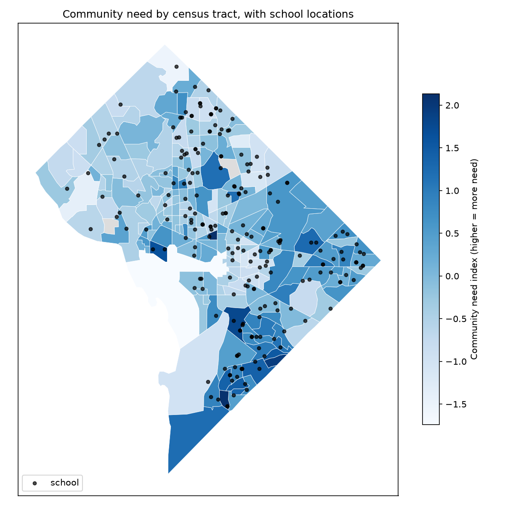
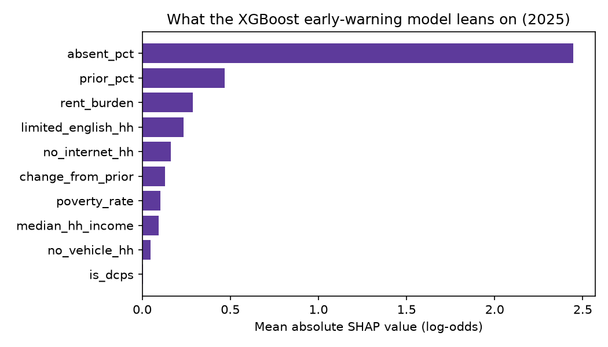

# Community Early-Warning: Chronic Absenteeism in DC Schools

A capstone project asking whether community-level context improves how schools identify
where students may need extra support, before attendance problems become chronic. It uses
public school-level data for Washington, DC, and ends in an interactive dashboard.

> **Status:** analysis and dashboard prototype complete for school-level data. The
> interview-text component and some planned methods are not done yet (see the end).

## Key findings

DC school years are labeled by the year they end (2021 = 2020-21). The outcome is whether a
school will be in the top quarter of DC schools for chronic absenteeism next year. PR-AUC is
a score for ranking rare cases; chance equals the share of positive schools.

- **Attendance history does most of the predicting.** Ranking DCPS schools by this year's
  rate gives PR-AUC of about 0.86 for next year's top-quarter schools (chance is 0.26).
- **Neighborhood (Census ACS) indicators did not improve on that.** For DCPS schools, adding
  them changed PR-AUC by -0.008 (95% interval -0.036 to +0.020).
- **Among schools not yet in the top quarter,** watching the 20% with the highest current
  rate caught 23 of the 28 that moved in over two test years (about 82%). The numbers are
  small and the uncertainty is wide.
- **Neighborhood indicators carry a modest signal.** They explain roughly 17% of the variation
  in school rates for schools in tracts the model had not seen: 23% for DCPS, 7% for charter
  schools, whose students come from across the city.
- **A methods lesson.** A random forest using only tract indicators looked strong (R^2 0.44
  with a random split) but fell to 0.05 when whole tracts were held out. It was memorizing
  schools, not learning a neighborhood pattern. Linear models did not have this problem.
- **A fairness check found one clear gap.** The list is much less precise for charter
  schools: about half of listed DCPS schools later entered the top quarter, against roughly
  one in eight charter schools (the intervals do not overlap). Capture was similar across
  groups but rests on few cases. The list also falls more often on schools in higher-poverty
  tracts (35% of them vs 10% in lower-poverty tracts), where more of the schools that moved
  in were.

These results come from about 230 schools and four year-to-year transitions. Treat them as
exploratory, not definitive.

## The dashboard

    python -m streamlit run app/streamlit_app.py

It shows a map of schools, a watch list of schools not yet in the top quarter with a capacity
slider and a backtest, community indicators near each DCPS school (transportation, internet,
housing cost, hardship, language access), the evidence above, and the limits. The backtest
simulates how a list would have performed; it does not show that any support would help.

## Data

Raw data is not stored in this repo.

- **OSSE DC School Report Card attendance files** (school-level chronic absenteeism, 2021-2025),
  downloaded from osse.dc.gov and placed in `data/raw/`.
- **U.S. Census Bureau ACS 5-year estimates (2019-2023),** tract-level, through the Census API.
- **DC Open Data school locations** (DCPS and charter), placed in `data/raw/`, and the Census
  Geocoder to assign each school a tract.

Nine schools could not be located (seven charter campuses missing from the location file and
two detention-site schools). The two detention-site schools and one school whose location could
not be verified are excluded; the seven unlocated charter campuses are kept but have no
neighborhood data.

## Method

- Evaluation moves forward in time: train on earlier years, test on a later year.
- Models: logistic regression and random forest, compared with the plain rule "rank by this
  year's rate." Feature sets: neighborhood only, attendance, plus school type, plus neighborhood.
- Uncertainty: bootstrap intervals that resample whole schools.
- Check for memorization: cross-validation that holds out entire census tracts.

## Reproduce

Set a free Census API key, then run in order:

    export CENSUS_API_KEY="your-key"
    python -m ewp.acs
    python -m ewp.osse
    python -m ewp.schools
    python -m ewp.panel
    python -m ewp.run_models
    python -m ewp.early_test
    python -m ewp.associations
    python -m ewp.grouped_check
    python -m ewp.dcps_check
    python -m ewp.fairness

Setup: `pip install -r requirements.txt` and `pip install -e .`; run `pytest` for the tests.

## Limitations

- Schools, not students: no student records are used, and tract indicators describe
  neighborhoods, not individual children (ecological fallacy).
- Associations, not causes.
- Small samples; 2021 was a pandemic-disrupted year.
- Charter schools draw students citywide, so a charter's tract is a weak proxy.

## Not done yet

- Fairness checks beyond school type, tract poverty, and grade level (for example ward,
  race/ethnicity, English learners, special education)
- Interview-text theme detection: `src/ewp/themes.py` is an untested starting point and
  needs real, consented interview data.

## Ethics

Outputs are framed as offers of support, not risk labels. Use the watch list to start
conversations, with human judgment first. See `docs/ethics_and_privacy.md`.

## License

MIT. See `LICENSE`.

## Hotspot analysis

`python -m ewp.hotspots` maps where community need and school absenteeism cluster. It downloads Census tract boundaries on first run and writes `reports/hotspots.txt` and two figures.

- Community need (an equal-weight average of standardized poverty, rent burden, no-vehicle and no-internet rates) clusters strongly across 204 DC tracts: Moran's I = 0.43, p = 0.001.
- 2025 school absenteeism also clusters: Moran's I = 0.37 for DCPS schools, 0.23 with charters included. Charters draw students citywide, so their location is a weak proxy.
- Getis-Ord Gi* finds 24 hot-spot schools (mean absenteeism 56%, mean need +0.72) and 24 cold-spot schools (mean 17%, mean need -0.37). Hot spots are mostly DCPS (17 of 24).
- A hot spot means a school's rate is high compared with its 8 nearest schools. It is not the same as high need. The hot-spot list is exploratory, with no multiple-testing correction. Unusual programs, such as an alternative school with a very high rate, should be checked before being reported.

Association only, not causation. Tract values describe neighborhoods, not individual students.

## XGBoost and SHAP

`python -m ewp.xgb_shap` adds gradient-boosted trees to the same early-warning test (schools not yet in the top quarter; 2024 and 2025 test years) and explains the model with SHAP.

- XGBoost did not beat the simple baseline of ranking schools by this year's rate (PR-AUC 0.32 vs 0.39). Only 28 schools moved into the top quarter, so differences are tentative.
- Adding neighborhood indicators did not help XGBoost either: PR-AUC change -0.004 (95% interval -0.119 to +0.109).
- SHAP: this year's absenteeism rate dominates (mean |SHAP| 2.45), followed by last year's rate (0.47). All other inputs are 0.29 or less.
- SHAP describes what the model uses, not what causes absenteeism. Neighborhood values are shared by every school in a tract, so flexible models can use them to recognize schools.

